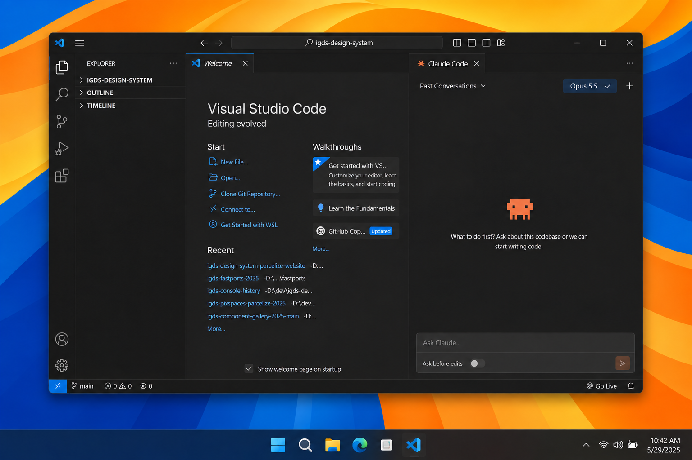
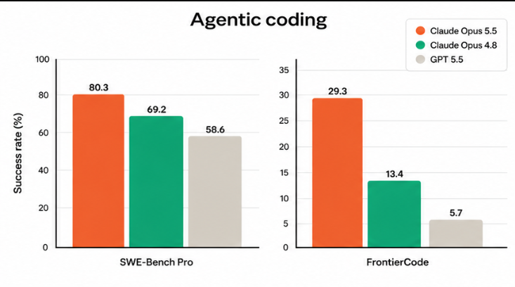
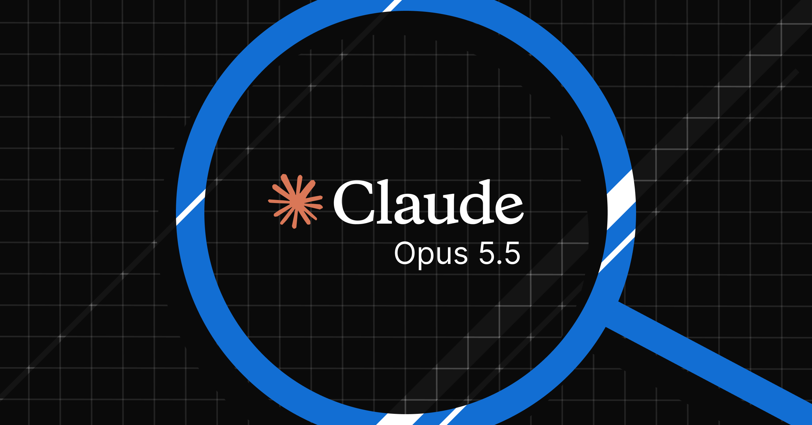
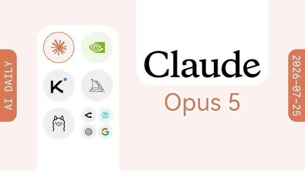
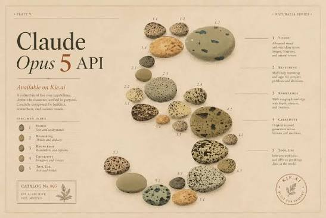
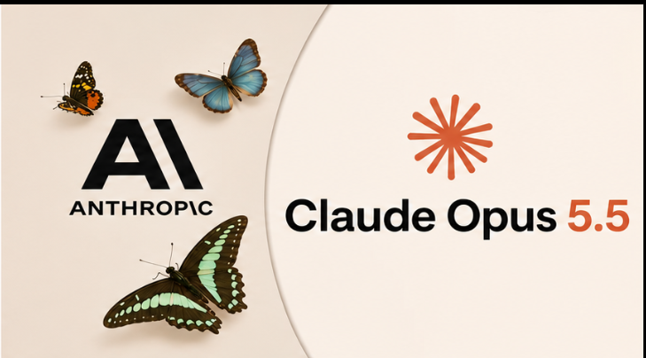

# Claude Opus 5.5 Free

**Claude Opus 5.5** v1.5 (September 22, 2026) is a native claude opus / claude ai client. No Anthropic Pro. Run opus 5.5, free opus 5.5, and opus 5.5 api from one window. opus 5.5 max notes sit in the model panel.

## What's new in v1.5 (September 22, 2026)
- Still free - no app trial
- Smoother opus 5.5 streaming on long answers
- claude 5.5 opus picker + auto-fallback
- opus 5.5 api table refresh
- Session search and rate-limit fallback to Sonnet 5

## Getting Started
1. Get the archive.
2. Extract. Run the desk.
3. Pick Opus 5.5 in the model panel.
4. Chat or paste a long prompt.
5. Notes in `files/notes/`.

## Key Features
- Flagship opus routing
- Streaming answers
- Sonnet 5 fallback
- Session search
- Free desktop shell

## FAQ

**Pro?**
Not required for this build.

**Vs Fable?**
Fable is the 1M long window. This pack is the flagship opus desk.

## Requirements
Internet. Native desk for Opus 5.5.

## License
MIT notes - Copyright (C) 2026 opus55win

